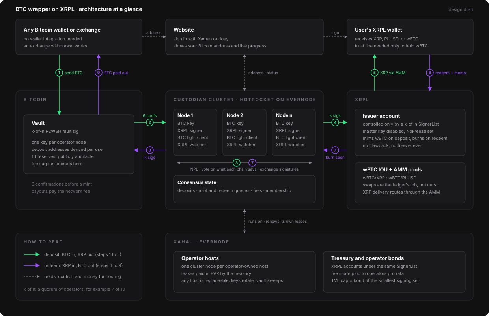

# BTC wrapper on XRPL: a federated custodian on Evernode

**Status:** design only. Nothing is built.

## Summary

Bitcoin comes onto XRPL as a 1:1 backed IOU (working name **wBTC**) minted by an issuer account whose only control is a k-of-n SignerList. The signers are the nodes of a HotPocket cluster running on Evernode, one node per operator-owned host. The same nodes hold the k-of-n keys of a Bitcoin P2WSH vault. The cluster does exactly two things: **mint on an observed deposit, pay out on an observed burn.** Swaps, pools and price discovery are the XRPL DEX and AMM's job, so a deposit can land as XRP or RLUSD in a single issuer payment routed through the AMM, and the user never has to hold wBTC unless they want to.

The security claim is honest and bounded: funds are safe while fewer than k operators collude or are compromised, and the deposit cap follows the operators' bonds. This is a **federation running on a DePIN** with replaceable hosts and self-funded hosting. It is not a trustless bridge, and the marketing must say so.

## What was verified (September 2026)

| Fact | How checked | Consequence |
|---|---|---|
| XLS-85 Token Escrow live on mainnet since 2026-02-12 | RippleX announcement, XLS spec | IOU escrows exist on XRPL |
| RLUSD issuer `rMxCKbEDwqr76QuheSUMdEGf4B9xJ8m5De` flags at ledger 106,770,849: RequireDestTag, DisallowXRP, DisableMaster, DefaultRipple, DepositAuth, **AllowTrustLineClawback**. **AllowTrustLineLocking is NOT set.** | `account_info` on xrplcluster.com | RLUSD cannot be escrowed, so no HTLC swap for RLUSD. Clawback means RLUSD is never censorship-resistant. Route BTC → XRP → RLUSD through the AMM instead. |
| XRPL escrow supports one crypto-condition, PREIMAGE-SHA-256; Bitcoin script has OP_SHA256 + CLTV | xrpl.org escrow docs | A plain BTC ↔ XRP HTLC atomic swap works today with no infrastructure. Kept as the non-custodial alternative (below). |
| HotPocket spawns the contract per consensus round (~1 s); filesystem state is under consensus; NPL is the channel for non-deterministic data and signature exchange; signer keys live in a per-node non-consensus directory; everpocket `XrplContext` multisigns as a cluster; **hosts can read everything in the instance** | docs.evernode.org contract protocol, NPL and multisig tutorials; everpocket README | The cluster pattern we need already exists for the XRPL side. Hosts must be the operators. |
| Evernode registry: **about 12,000 hosts**, moment = 3,600 s. A typical small host: 2 vCPU, about 6 GB RAM, 55 GB disk, 3 slots (about 2 GB RAM and 18 GB disk per instance), lease around 0.001 EVR per moment | live `evernode-js-client` query | Compute is there and effectively free. A Bitcoin light client fits; a full node does not. |
| Leases expire silently and purge state; no in-place update path; everpocket `ClusterContext` and `NomadContext` are marked work in progress | docs + repo | Rotation and lease renewal must be automated from day one, and we probably finish those libraries ourselves. |
| XLS-82 (MPTs on the DEX and AMM) exists as an amendment but MPT parity with IOUs is still being rolled out | opensource.ripple.com, XRPL standards | Issue a classic IOU, not an MPT. |

## Architecture

Green arrows are a deposit (BTC in, XRP out, steps 1 to 5). Purple arrows are a redemption (XRP in, BTC out, steps 6 to 9). Dashed grey is reads, control, and money for hosting.

### Components

**Issuer account (XRPL).** Controlled only by a k-of-n SignerList (weights 1, quorum k, up to 32 signers). Master key disabled after the SignerListSet, no RegularKey. Flags: DefaultRipple, **NoFreeze** (irreversible), and the clawback flag is never set. It holds no funds; wBTC is simply its obligations, so supply is readable by anyone with `gateway_balances`.

**Vault (Bitcoin).** A k-of-n P2WSH multisig (`OP_k <sorted pubkeys> OP_n OP_CHECKMULTISIG`, n ≤ 20; Tapscript `CHECKSIGADD` if we ever need more). Each operator also publishes an xpub. Deposit address *i* is the same script built from child key *i* of every operator's xpub, so every user gets a unique address that is spendable by the same quorum, with no memo or OP_RETURN. UTXOs are consolidated into the main vault address on quiet days.

**Custodian cluster (HotPocket on Evernode).** n nodes, one per operator-owned host. Consensus state: deposit ledger (address index → XRPL address and delivery preference), observed deposits with confirmation counts, mint queue, redeem queue, fee ledger, membership (operator pubkeys, xpubs, XRPL signer addresses, bonds). Per node and outside consensus: the Bitcoin private key, the XRPL signer secret, a Bitcoin light client (Neutrino / BIP157), and an XRPL watcher on its own connection. Nothing enters state until the nodes have voted on it over NPL.

**Website.** Sign in with Xaman or Joey. Reads cluster state over the HotPocket WebSocket (read requests, no consensus cost). Xaman payloads for the trust line and the redeem payment. No Bitcoin wallet integration: users copy an address.

**Treasury and bonds (XRPL and Xahau).** XRPL accounts under the same SignerList hold operator bonds and the accumulated fee share. A Xahau tenant account, multisigned through everpocket's `EvernodeContext`, pays the EVR leases.

## Flows

### Deposit

1. User signs in and picks the delivery asset: XRP (default), RLUSD, or wBTC. For wBTC the site requests a TrustSet through Xaman first. RLUSD requires the user to already hold an RLUSD trust line (permissionless).
2. The cluster assigns the next address index to the user's XRPL address (a consensus write) and returns the P2WSH address. The site shows it with a QR code. The address is permanent for that user.
3. The user sends BTC from any wallet or exchange. Each node's light client sees the transaction; nodes vote over NPL at each confirmation; state records `seen → 1..6 confirmations`. The site shows the progress live.
4. At 6 confirmations state enqueues a mint: deposit minus the mint fee. Minimum deposit 50,000 sats; smaller deposits are credited and held until the user's total crosses the minimum.
5. Every node builds the identical issuer Payment. For wBTC: `Amount` = wBTC to the user. For XRP or RLUSD: `Amount` = XRP or RLUSD, `SendMax` = wBTC, `Paths` through the AMM, `tfPartialPayment` with `DeliverMin` from the rate quoted at deposit time minus a 1% tolerance. k nodes sign, signatures cross NPL, one node submits, all nodes watch for validation, state marks the mint done with the hash. XRP delivery works even to an account that does not exist yet, as long as the amount meets the reserve.

Elapsed time is about an hour, set by Bitcoin.

### Redeem

1. User enters a Bitcoin address (bech32 validated) and an amount. The site builds one Payment to the issuer: `Amount` = wBTC to the issuer (a payment of its own IOU to the issuer is a burn), `SendMax` and AMM `Paths` if the user is paying in XRP or RLUSD, and `Memos[0]` carrying the Bitcoin address. Xaman signs.
2. Every node's XRPL watcher sees the validated payment; nodes vote over NPL; state enqueues a payout: burned amount minus the redeem fee minus the network fee. An unparseable memo refunds the wBTC to the sender in full.
3. Every node builds the identical PSBT (deterministic coin selection over the consensus-known UTXO set, fee rate voted over NPL). k nodes sign, signatures cross NPL, one node broadcasts, all track confirmation, state marks the payout done with the txid.

Elapsed time is 4 seconds on XRPL plus one Bitcoin confirmation. The user sees the payout in the mempool within minutes.

### Membership rotation and vault sweep

Adding or removing an operator is one procedure: the new node generates its keys and publishes pubkey, xpub and XRPL signer address; the current quorum signs a SignerListSet; the new vault script is derived; the current quorum signs a sweep of all vault UTXOs to the new vault. New deposit addresses derive from the new xpub set. Old deposit addresses stay watched and spendable by the old quorum for 30 days, then are retired in the UI.

Rotation must complete while at least k old keys are still live. Rule: **rotation starts the moment one node is lost**, not when the situation becomes urgent.

### Fee sweep

Fees accrue as vault surplus: BTC in the vault exceeds wBTC in circulation. Monthly, the quorum pays operators their pro rata share (as freshly minted wBTC against the surplus, or as BTC). 20% stays in the treasury for network fees and leases.

### Lease renewal

There is no lease-expiry query on Evernode, so each node computes its own expiry from acquire time plus moments times moment size. The cluster multisigns lease extensions from the Xahau tenant account 24 moments ahead. Fee share is converted to XAH and EVR on the Xahau DEX as needed, manually at first.

## Trust model and game theory

- **Threat.** Any k operators, or the hosts they run on (the same party, by design), can steal the vault or mint unbacked wBTC. Fewer than k can do nothing. Losing n − k + 1 keys freezes the vault forever.
- **Hosts read everything in the instance.** Therefore no host may hold k or more nodes, and ideally the hosts are the operators themselves.
- **Bonds.** Each operator posts a bond in XRP into a treasury account under the same SignerList. Theft is provable by anyone: a vault spend with no matching burn in consensus state. The honest remainder confiscates the bond and removes the operator. That only deters when the bond exceeds the prize, so the **TVL cap equals the combined bond of the k operators with the smallest bonds.** The cluster refuses new deposits above the cap and the site says so.
- **Reality.** At a 0.3% round trip and monthly turnover equal to TVL, bonds earn roughly 3 to 4% a year. That does not attract capital by itself. v1 is a reputation federation of named XRPL ecosystem operators with modest bonds and a low cap; the cap rises with track record. v2 adds emissions or a treasury share if the market wants a higher cap. Comparables: Liquid (11-of-15 named functionaries with HSMs), tBTC v2 (bonded T, 51-of-100), sBTC (stacked STX). None run unbonded anonymous signers.
- **What Evernode contributes.** A replicated runtime where every node runs identical, consensus-enforced code and state; hosts that can be swapped without anyone's server; and hosting paid from the protocol's own treasury. It contributes no custody security. "Unstoppable" describes the coordinator, not the custody.

## Fees and economics

| Lever | v1 setting | Notes |
|---|---|---|
| Mint fee | 0.1% | Taken in BTC at deposit |
| Redeem fee | 0.2% plus network fee | Taken in BTC at payout |
| TransferRate on the IOU | 0 | Available (0 to 100%, burned on every transfer between users, including DEX trades) but rejected: a Bitcoin that shrinks on every hop trades at a discount and loses to any fee-free wrapper |
| Operator payout | pro rata by bond | Monthly fee sweep |
| Treasury retention | 20% of fees | Network fees, leases, initial AMM liquidity |

Hosting is not the cost. An Evernode lease is around 0.001 EVR per hour and a VPS is a few dollars a month. The cost operators bear is risk, and the bond and cap are how the design prices it.

## User experience

**Deposit.** Open the site, sign in with Xaman or Joey, choose XRP, RLUSD, or wBTC, copy the Bitcoin address or scan the QR, send from anywhere, watch the confirmations tick, receive. One Xaman tap only if they chose to hold wBTC (the trust line).

**Redeem.** Enter a Bitcoin address and an amount, sign one Xaman payload, see BTC in the mempool within minutes.

**Wallet realities.** Bitcoin has no "connect wallet" standard, so none is used; an exchange withdrawal is a first-class deposit path.

## Decisions

| Decision | Rejected alternative | Why |
|---|---|---|
| Classic IOU | MPT | The AMM has traded IOUs since 2024; XLS-82 MPT parity is still rolling out |
| P2WSH k-of-n | FROST / Taproot threshold key | No distributed key generation or resharing; each node's key is independent; 20 keys is enough for v1 |
| Fee on mint and redeem | TransferRate | Fee-on-transfer makes the token trade at a discount |
| Hosts are the operators | Anonymous Evernode hosts | Hosts read the instance; a key on a stranger's server is the stranger's key |
| Derived deposit addresses | OP_RETURN tagging | Works from exchanges; needs no wallet features |
| NoFreeze set, master disabled, no clawback | Issuer keeps freeze and clawback | The point of the product; it also removes the operator set as a censorship lever |
| XRP delivery through the AMM inside the mint payment | User swaps after minting | One step for the user; no trust line needed to receive XRP |

## Alternatives considered

- **Pure HTLC atomic swap, BTC ↔ XRP, with Evernode as matcher and watchtower.** Trustless, and technically possible today. Rejected as the product because both parties must be online, the taker holds a free option while the price moves, each swap takes about an hour, no consumer wallet builds P2WSH HTLCs, and RLUSD is excluded until Ripple sets AllowTrustLineLocking. Worth revisiting as a "trustless mode" for large swaps once the wrapper has users.
- **Centralized BTC IOU.** GateHub already issues one on XRPL. It is the incumbent; our differentiators are replaceable hosts, k-of-n control, public bonds, and NoFreeze.
- **FROST / Taproot.** Cheaper on chain and no signer ceiling, at the price of DKG and resharing. v2.

## Risks and open questions

- everpocket `ClusterContext` and `NomadContext` are work in progress upstream; assume we finish them.
- A missed lease renewal purges a node and its key. Rotation and renewal are automated in v0, not later.
- Confirm the HotPocket image lets a long-lived Bitcoin light client run beside the per-round contract process, or run it as a sidecar the contract queries over localhost. First thing v0 verifies.
- Reorgs deeper than 6 blocks: pause mints, manual review.
- AMM slippage on XRP delivery: quote at deposit, `DeliverMin` with 1% tolerance; if the payment fails, hold the mint in the queue and retry, or deliver wBTC if the user has a trust line. Decide in v0.
- Legal: an identifiable issuer of a Bitcoin-backed token. Get a read before mainnet.
- Liquidity: the AMM pools need seeding or the XRP route is useless. Budget initial LP from the treasury.
- Key loss: with 7-of-10, losing 4 keys freezes the vault. Rotation triggers on the first loss.
- CHECKMULTISIG caps at 20 keys; Tapscript if the federation outgrows that.
- Evernode Labs: worth a conversation about support before v1.

## Staging

| Stage | Scope | Effort | Done when |
|---|---|---|---|
| v0 | 5 nodes on hosts the operators control, Bitcoin signet + XRPL testnet, mint, redeem, AMM swap, rotation demo | 3 to 6 weeks | A signet deposit lands as testnet XRP end to end; a redeem returns signet BTC; one node is replaced and the vault swept without downtime |
| v1 | Named operators, bonds, TVL cap, self-renewing leases, reserves page, mainnet with a low cap | 2 to 3 months | Cap raised once after a clean month |
| v2 | Bonds and slashing enforced by a Xahau hook, Taproot threshold signing, emissions if needed | Open | Decided by demand |

## References

- HotPocket contract protocol: https://docs.evernode.org/en/latest/sdk/hotpocket/reference/contract-protocol.html
- HotPocket NPL tutorial: https://docs.evernode.org/en/latest/sdk/hotpocket/tutorials/npl.html
- HotPocket multisig cluster tutorial: https://docs.evernode.org/en/latest/sdk/hotpocket/tutorials/multisig.html
- everpocket-nodejs-contract: https://github.com/EvernodeXRPL/everpocket-nodejs-contract
- Evernode deployment concepts: https://docs.evernode.org/en/latest/sdk/evernode/tutorials/deployment-concepts.html
- XLS-85 Token Escrow: https://xls.xrpl.org/xls/XLS-0085-token-escrow.html
- XLS-82 MPT DEX integration: https://opensource.ripple.com/docs/xls-82-mpt-dex
- XRPL conditional escrows: https://xrpl.org/docs/tutorials/javascript/send-payments/create-conditional-escrows
